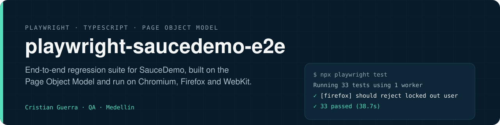
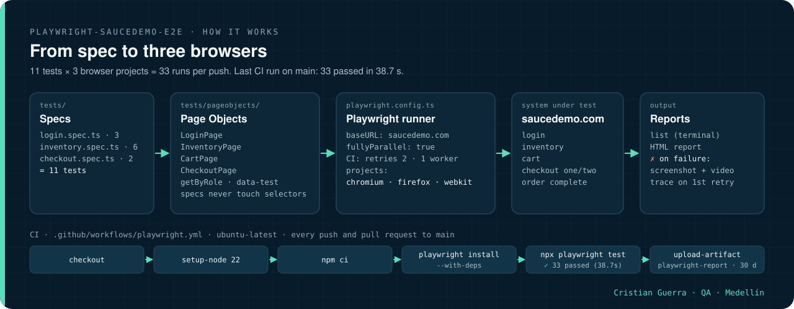

[Read in English](README.md)

<p align="center">
  
</p>

# Playwright SauceDemo E2E

Suite de regresión end-to-end para [SauceDemo](https://www.saucedemo.com) hecha con Playwright y TypeScript, organizada con el Page Object Model y ejecutada en varios navegadores en cada push.

[](https://github.com/criguex/playwright-saucedemo-e2e/actions/workflows/playwright.yml)


## Cómo funciona

<p align="center">
  
</p>

1. Un spec (`login`, `inventory` o `checkout`) describe el flujo del usuario con llamadas de intención.
2. Los Page Objects son dueños de todos los localizadores y convierten esas llamadas en clics, campos llenos y aserciones.
3. `playwright.config.ts` corre cada spec una vez por proyecto de navegador (Chromium, Firefox, WebKit) contra `https://www.saucedemo.com`.
4. La terminal muestra el reporter `list`; el reporte HTML guarda el pantallazo y el video de cualquier prueba que falle, y el trace en el primer reintento.

<p align="center">
  
</p>

La animación reproduce el log real del run de CI [36095558718](https://github.com/criguex/playwright-saucedemo-e2e/actions/runs/36095558718) (también en [MP4](docs/assets/how-it-works.mp4)).

## Qué prueba

| Spec | Escenarios |
|---|---|
| `tests/login.spec.ts` | Login exitoso con `standard_user`; el usuario bloqueado es rechazado; con credenciales inválidas aparece el mensaje de error esperado |
| `tests/inventory.spec.ts` | El catálogo lista 6 productos; orden por nombre (A-Z, Z-A) y por precio (menor a mayor, mayor a menor); agregar un producto actualiza el contador del carrito |
| `tests/checkout.spec.ts` | Flujo completo de compra (agregar dos productos, revisar el carrito, datos de envío, resumen de la orden, confirmación); quitar un producto del carrito antes del checkout |

11 pruebas, ejecutadas en Chromium, Firefox y WebKit.

**Último resultado de CI en `main`** (run 36095558718, 2026-09-25): `Running 33 tests using 1 worker` → `33 passed (38.7s)`.

## Arquitectura

- **Page Object Model**: una clase por página (`LoginPage`, `InventoryPage`, `CartPage`, `CheckoutPage`) es dueña de sus localizadores y expone acciones y aserciones de intención. Los specs nunca usan selectores directamente.
- **Localizadores**: por rol (`getByRole`) y atributos `data-test`; nada de XPath.
- **Configuración** (`playwright.config.ts`): `baseURL`, tres proyectos de navegador, ejecución totalmente paralela, reintentos y un solo worker en CI, trace en el primer reintento, pantallazos y videos solo cuando algo falla.

## Cómo correrlo

Requiere Node.js 18 o superior.

```bash
git clone https://github.com/criguex/playwright-saucedemo-e2e.git
cd playwright-saucedemo-e2e
npm ci
npx playwright install --with-deps

npm test                                  # todos los navegadores, headless
npm run test:chromium                     # un solo navegador
npx playwright test tests/checkout.spec.ts
npm run test:headed
npm run test:ui
npm run report                            # abre el último reporte HTML
```

## Estructura del proyecto

```
.
├── .github/workflows/playwright.yml
├── docs/
│   ├── assets/        banner.svg, how-it-works.svg, how-it-works.gif, how-it-works.mp4
│   └── scenes/        how-it-works.html + export.sh (regenera la animación)
├── tests/
│   ├── pageobjects/
│   │   ├── LoginPage.ts
│   │   ├── InventoryPage.ts
│   │   ├── CartPage.ts
│   │   └── CheckoutPage.ts
│   ├── login.spec.ts
│   ├── inventory.spec.ts
│   └── checkout.spec.ts
├── playwright.config.ts
└── package.json
```

## Reportes

- Reporter `list` en la terminal y un reporte HTML en `playwright-report/` (`npm run report`).
- En CI el reporte HTML se sube como artefacto del build (se guarda 30 días) con los traces, pantallazos y videos de cualquier prueba que falle.

## CI

GitHub Actions (`.github/workflows/playwright.yml`) corre la suite completa en Ubuntu en cada push y pull request a `main`.

## Límites

- La suite corre contra el demo público `saucedemo.com`, así que si ese sitio se cae, la ejecución falla.
- Cubre solo flujos de interfaz: no tiene pruebas de API, accesibilidad ni regresión visual.

## Regenerar la animación

`docs/scenes/how-it-works.html` dibuja cada cuadro a partir de `?t=<segundos>`; `docs/scenes/export.sh` captura los cuadros con Chrome headless y arma `how-it-works.gif` y `how-it-works.mp4` con ffmpeg.

---

Cristian Guerra · Senior SDET · [linkedin.com/in/criguex](https://www.linkedin.com/in/criguex)
